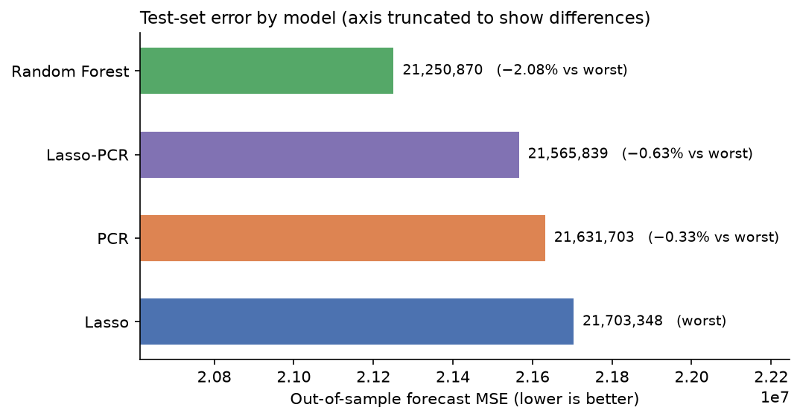
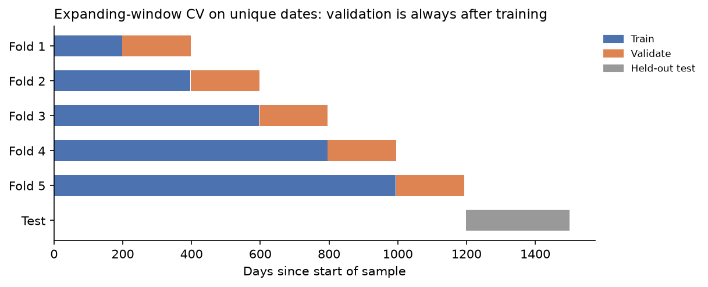
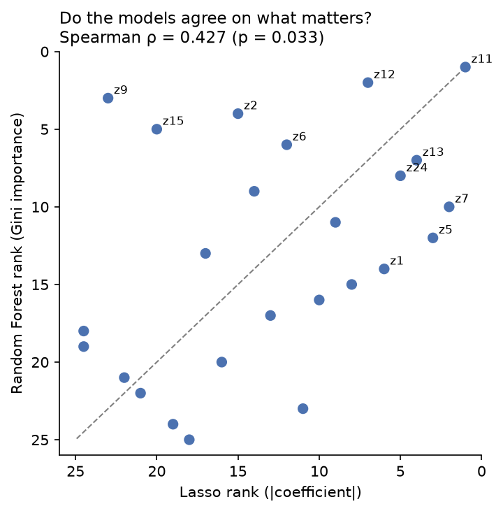
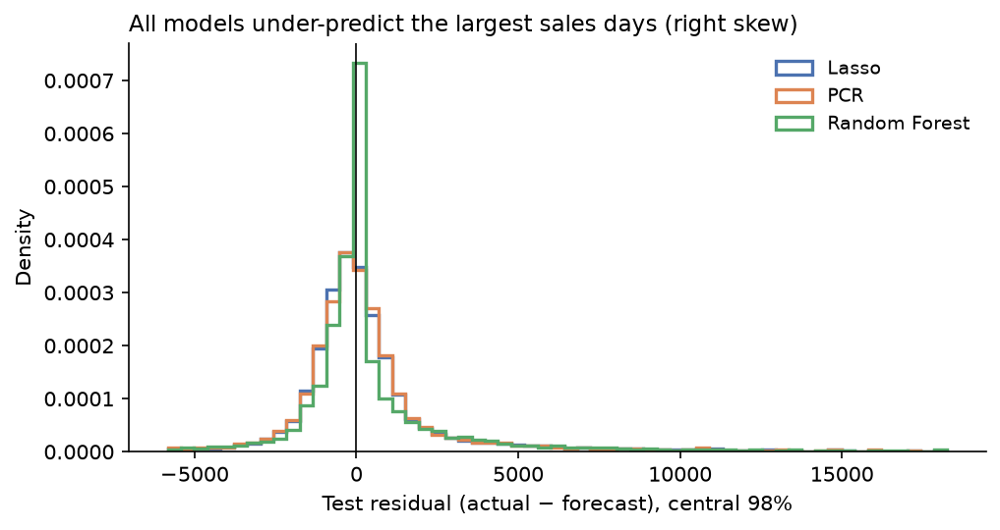

# Predictive Modelling for Sales Forecasting

[](https://github.com/Yogcarmen/ml-sales-forecasting-comparison/actions/workflows/ci.yml)

Benchmarking Lasso, Principal Component Regression (PCR), and Random Forest on a 25-firm panel dataset for one-period-ahead sales forecasting, with an emphasis on time-aware cross-validation and cross-model feature importance agreement.



**In one line:** Random Forest forecasts best, but only by about 2% over linear models, so most of the predictable signal is linear; all models miss the largest sales days, which points to drivers outside the 25 predictors.

## Quick start (no data needed)

The original dataset is under a course licence, so the repo ships a **synthetic panel generator** with the same layout. Everything runs end to end without the licensed file:

```bash
git clone https://github.com/Yogcarmen/ml-sales-forecasting-comparison.git
cd ml-sales-forecasting-comparison
pip install -r requirements.txt

python scripts/run_pipeline.py --synthetic --fast   # 1–2 minutes, writes results/
pytest -q                                           # checks for look-ahead leakage
```

With the original file in `data/`, run `python scripts/run_pipeline.py --data data/DS2.xlsx` to reproduce the results below (full 320-combination Random Forest grid, about 35 minutes on a laptop).

## Overview

Standard k-fold cross-validation draws validation samples randomly, which allows future observations to leak into training folds. This project addresses that by implementing `PanelTimeSeriesCV`: an expanding-window CV that splits on unique dates, so all 25 firms at a given date always belong to the same fold and validation windows are strictly forward-looking. Hyperparameter selection for all models (λ for Lasso, component count for PCR, grid search for RF) uses this procedure exclusively on the training set; the held-out test set is used only for final evaluation.



## Dataset

A panel of 25 firms with 25 standardised numeric predictors (`z1`–`z25`) and company fixed effects. The target is next-period sales (`y_future`), constructed as a one-period lead of the observed sales variable. Data is split chronologically: the first 80% of unique dates form the training set and the remaining 20% form the test set.

The dataset is not included in this repository (course licence). See `data/README.md` for the expected format.

## Methodology

**Lasso** — numeric predictors standardised, company dummies one-hot encoded. `LassoCV` selects λ* minimising CV MSE across 5 time-aware folds over a 100-point log-spaced grid in [10⁻⁴, 10²].

**PCR** — PCA applied to 25 standardised numeric predictors; components retained up to 95% cumulative variance threshold. OLS fitted on [PC scores | company dummies]. Company dummies are excluded from PCA to preserve their role as fixed-effect intercept shifters.

**Random Forest** — scale-invariant; no standardisation. `GridSearchCV` over `n_estimators` × `max_depth` × `max_features` × `min_samples_leaf` (320 combinations × 5 folds). Final model refitted with `oob_score=True`.

**Lasso-PCR extension** — joint CV over (λ, k): Lasso selects z-features per fold, PCA reduces to k components, OLS fits on [PC scores | dummies]. Optimal (λ*, k*) chosen from a 25 × 15 grid.

**Feature importance agreement** — Lasso |coefficient| rankings and RF Gini importance rankings compared via Spearman rank correlation across all 25 z-features, providing model-agnostic evidence of predictive signal.

## Key Results

| Model | Train FMSE | Test FMSE | Gen. Gap | Key Parameter |
|---|---|---|---|---|
| Lasso | 10,727,815.65 | 21,703,347.87 | 10,975,532.22 | λ* = 3.05 |
| PCR | 10,729,501.52 | 21,631,702.74 | 10,902,201.22 | k = 19 PCs (95.25% var) |
| Random Forest | 7,021,864.59 | 21,250,870.30 | 14,229,005.71 | 500 trees, depth=None, max_features=0.3, min_leaf=10 |
| Lasso-PCR | 10,741,964.29 | 21,565,839.11 | 10,823,874.82 | λ* = 10, k* = 15 PCs |

Random Forest achieves the lowest test FMSE, outperforming PCR by 1.76% and Lasso by 2.08%; PCR in turn lowers test FMSE relative to Lasso by 0.33%. The modest spread between best and worst model (2.08%) indicates most of the predictive information is recoverable through linear structure alone. Random Forest's much larger generalisation gap (14.2M vs ~10.8–11.0M for the linear models) reflects a lower-bias, higher-variance specification: its OOB R² is 0.396, with no directly comparable in-sample statistic available for the linear models. Lasso-PCR, which pre-filters z-features by Lasso before PCA rotation, improves on standalone PCR by only 0.30%, indicating that the broad factor structure and persistent company fixed effects are already the dominant source of linear predictive power.

**Feature importance agreement.** Spearman rank correlation between Lasso |coefficient| and RF Gini importance across the 25 z-features is ρ = 0.427 (p = 0.033), a statistically significant agreement at the 5% level. Both methods converge on customer engagement and demand-side indicators (retention, satisfaction, purchasing power) as leading predictors, while diverging on variables likely driven by thresholds or interaction effects rather than smooth linear relationships (e.g. `z9` and `z15`, ranked highly by the forest but near the bottom by Lasso).



**Residual analysis.** All three models produce right-skewed residual distributions on the test set, indicating systematic under-prediction of high-sales observations. Residual means are comparable across models (Lasso: 713.1, PCR: 708.9, Random Forest: 784.2), as are standard deviations (Lasso: 4,603.8, PCR: 4,596.6, Random Forest: 4,543.0). The persistent right skew across all specifications suggests extreme sales events are driven by factors outside the 25 observed predictors.



**Robustness — winsorisation (1%/99%, training-set bounds).**

| Model | Original FMSE | Winsorised FMSE | Δ% | Rank (orig → wins.) |
|---|---|---|---|---|
| Lasso | 21,703,347.87 | 21,697,277.04 | −0.03% | 3 → 3 |
| PCR | 21,631,702.74 | 21,633,514.82 | +0.01% | 2 → 2 |
| Random Forest | 21,254,213.48 | 21,231,663.14 | −0.11% | 1 → 1 |
| Lasso-PCR | 21,565,839.11 | 21,569,088.35 | +0.02% | — |

Model ranking is unchanged after winsorisation for all four models, confirming the comparative conclusions do not depend on extreme predictor values. (Residual statistics and the winsorisation table come from the original run; a re-run with scikit-learn 1.9 changes the Random Forest test FMSE by 0.02%, 21,254,213 → 21,250,870, and leaves the linear models unchanged.)

## Synthetic data

`src/synthetic.py` simulates 25 firms × daily dates with a factor structure in the predictors, persistent firm fixed effects, right-skewed sales, one threshold effect and fat-tailed shocks. Today's predictors drive tomorrow's sales, matching the forecasting target. Because the true predictors are known, a synthetic run also reports how many of them each model recovers. Synthetic numbers are not meant to match the results above. See `data/README.md`.

## File Structure

```
ml-sales-forecasting-comparison/
├── README.md
├── requirements.txt
├── .github/workflows/ci.yml  # tests + synthetic smoke run on every push
├── assets/                   # figures used in this README
├── data/
│   └── README.md             # data format + synthetic option
├── scripts/
│   └── run_pipeline.py       # end-to-end run: table + figures
├── src/
│   ├── cv.py                 # PanelTimeSeriesCV
│   ├── data_loader.py        # load_data (file or synthetic), chronological_split
│   ├── models.py             # train_lasso, train_pcr, train_rf, train_lasso_pcr
│   ├── synthetic.py          # synthetic panel generator
│   └── utils.py              # fmse, constants, save_fig
├── tests/
│   └── test_pipeline.py      # no look-ahead in CV/split, data layout
├── notebooks/
│   └── results.ipynb         # original exploratory notebook
└── results/                  # generated outputs (git-ignored)
```
